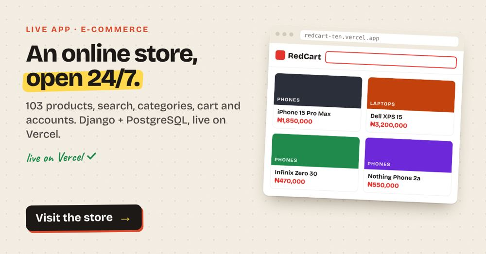

# 🛒 RedCart — Retail-Logistics-Core

[](https://github.com/peterafolabi-dev/Retail-Logistics-Core/actions/workflows/ci.yml)


An e-commerce platform built solo with **Django + PostgreSQL**, with a **Next.js + TypeScript** storefront, a Groq-powered AI shopping assistant, a Paystack checkout and fraud-aware review moderation.

| | Link |
|---|---|
| Django store | [redcart-ten.vercel.app](https://redcart-ten.vercel.app) (Vercel + Neon Postgres) |
| Next.js storefront | [redcart-storefront.vercel.app](https://redcart-storefront.vercel.app) |
| Payments | Paystack in **test mode**: use Paystack's public test card, no real money moves |



**📖 Read the [case study](docs/CASE_STUDY.md)**: the problem, architecture diagrams, how the AI assistant avoids making things up, and the hard parts.

---

## Engineering decisions

The choices I'd want a reviewer to see, and why I made them:

- **One source of truth for money.** The Next.js storefront only *reads* the catalog through a versioned, read-only API (`/products/api/v1/`). Cart, checkout, payments and accounts stay in Django, so there is exactly one place where orders and balances can change.
- **Never trust the browser about payments.** After checkout, the server calls Paystack's `transaction/verify` endpoint with the reference before an order is marked paid. A redirect back to the site proves nothing on its own.
- **No double credits.** Referral rewards are paid into wallets inside a database transaction with `select_for_update()`, so two requests arriving at the same time can't credit the same reward twice. Re-opening a payment link is also safe: a Paystack reference that was already processed is not turned into a second order.
- **The AI is not allowed to guess.** Order status and stock come straight from the database. The model only phrases answers. Policy answers come from a small retrieval layer over real policy documents (`products/rag.py`), and a regression script (`scripts/evaluate.py`) checks the guardrails after changes.
- **Fraud scoring that fails safe.** Only high-confidence fraud is auto-hidden. Borderline reviews stay public and are flagged for staff, so a false positive never silently buries a real customer.
- **CI on every push.** GitHub Actions runs `manage.py check`, a missing-migrations check, the 98 Django tests and a TypeScript check of the storefront.

---

## 🤖 AI Shopping Assistant

The centerpiece feature: a chatbot built on Groq, designed to be genuinely trustworthy rather than just conversational.

- **Intent-aware routing** — greetings, small talk, product questions, policy questions, and order lookups are each handled differently, so the bot doesn't dump the whole catalog into a reply to "hi"
- **Retrieval-augmented knowledge base** — shipping, returns, warranty, and payment questions are answered from real policy documents, not invented on the fly
- **Guardrails** — the bot will never pretend to add something to your cart, invent a discount, or claim an item is out of stock when it isn't; it's built to say "I don't know" rather than guess
- **Persistent conversation history** — a full sidebar lets both logged-in users and guests revisit past chats, backed by real database storage, not just browser session state
- **Rate limiting and response validation** — protects against abuse and automatically retries responses that come back malformed
- **Direct database order lookups** — order status and tracking numbers are pulled straight from the database, never guessed by the AI

The `scripts/evaluate.py` regression suite checks all of the above automatically after any change.

---

## 🛡️ Review Fraud Detection

A tiered fraud-scoring system runs on every review and comment:

- Flags near-duplicate text copied across reviews, review bursts on a single product, brand-new accounts posting immediately, and generic text paired with extreme ratings
- High-confidence fraud is auto-hidden pending staff approval; borderline cases stay published but are flagged for manual review — genuine customer feedback is never silently buried on a false positive
- Full moderation queue built into the Django admin, with one-click approve/hide actions

---

## 🔑 Core Platform Features

- **Authentication** — email/password plus Google OAuth (via django-allauth)
- **Payments** — Paystack checkout (test mode) for card and bank transfer, verified server-side before an order is marked paid, plus an internal wallet
- **Order management** — full order lifecycle (pending → confirmed → shipped → delivered), tracking numbers, PDF invoices
- **Product catalog** — categories, flash sales with live countdown timers, price history tracking, stock/variant management
- **Wishlist, reviews & ratings, product recommendations** (AI-assisted, using the same Groq integration as the chatbot)
- **Support system** — ticketed customer support, FAQ system, contact form
- **Notifications** — in-app notification center with read/unread tracking
- **Wallet system** — internal wallet balance with top-up and spend tracking
- **Newsletter** — subscribe/unsubscribe with confirmation emails

---

## 📂 Project Structure

```
products/
    models.py             # Product, Order, Review, ChatConversation, and all core models
    views.py               # Request handling for the whole storefront
    utils.py                # Chatbot logic, email sending, stock management
    prompts.py             # Centralized AI system prompts
    rag.py                    # Lightweight document retrieval for the chatbot
    fraud_detection.py     # Review/comment fraud scoring engine
    knowledge/             # Markdown knowledge base the chatbot searches
    admin.py                # Django admin customization, including moderation tools
templates/                # HTML templates (Bootstrap + Tailwind hybrid)
mywork/                    # Project settings and URL configuration
scripts/                   # Maintenance helpers and chatbot regression suite
    evaluate.py
manage.py
```

---

## 🛠️ Running Locally

1. Clone the repository:
   ```bash
   git clone https://github.com/peterafolabi-dev/Retail-Logistics-Core.git
   cd Retail-Logistics-Core
   ```
2. Install dependencies:
   ```bash
   pip install -r requirements.txt
   ```
3. Set up environment variables (see `.env.example` if present, or check `settings.py` for required keys — Groq API key, Paystack keys, Google OAuth credentials, database URL).
4. Run migrations:
   ```bash
   python manage.py makemigrations
   python manage.py migrate
   ```
5. Start the server:
   ```bash
   python manage.py runserver
   ```

### Running the tests
```bash
python manage.py test        # 98 Django tests
npx tsc --noEmit             # storefront typecheck
```

Older build notes and guides live in [`docs/notes/`](docs/notes/).

### Running the chatbot test suite
```bash
python scripts/evaluate.py
```
Checks intent classification, guardrails, rate limiting, and RAG retrieval. Live model checks (requiring a configured `GROQ_API_KEY`) run automatically if the key is present, and skip gracefully otherwise.

---

## 🚀 Deployment

The Django store runs on Vercel with a Neon Postgres database (`render.yaml` is kept for a Render deployment). It uses:
- PostgreSQL for production data (SQLite for local development)
- Gunicorn as the WSGI server
- WhiteNoise for static file serving
- Tailwind CSS compiled at build time via `build.sh`

---

## 👤 Author

Afolabi Peter · [LinkedIn](https://www.linkedin.com/in/afolabipeter-dev)
Computer engineering student, FUT Minna — building RedCart solo while learning Django along the way.

---

## Next.js storefront (`app/`)

A fast, server-rendered storefront built with Next.js 15, React 19 and Tailwind. It reads the live catalog from Django's read-only API and hands off to Django for cart, checkout, Paystack payments and accounts, so there is one source of truth for orders and money.

| Endpoint | What it returns |
|---|---|
| `GET /products/api/v1/products/` | Paginated products. Query params: `q`, `category`, `sort` (`newest`, `price_asc`, `price_desc`, `name`), `on_sale=1`, `page`, `page_size` (max 48) |
| `GET /products/api/v1/products/<id>/` | One product with images, stock, published reviews and related items |

Pages: home (hero, categories, flash deals, new arrivals), `/shop` (search, category filter, sort, pagination, deals), `/shop/<id>` (gallery, sale price and countdown date, stock, reviews, related products).

### Run it locally

```bash
# terminal 1: Django on :8000
python manage.py runserver
# terminal 2: storefront on :3000
REDCART_API_URL=http://127.0.0.1:8000 npm run dev
```

### Deploy

1. Import the repo into Vercel (framework: Next.js, root directory: repo root).
2. Set `REDCART_API_URL` to the Django service URL, e.g. `https://redcart-ten.vercel.app`.
3. On Render, set `STOREFRONT_ORIGINS` to the Vercel URL so browsers may call the API directly.
