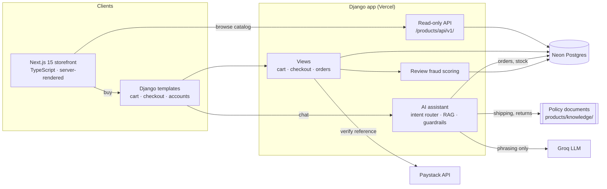
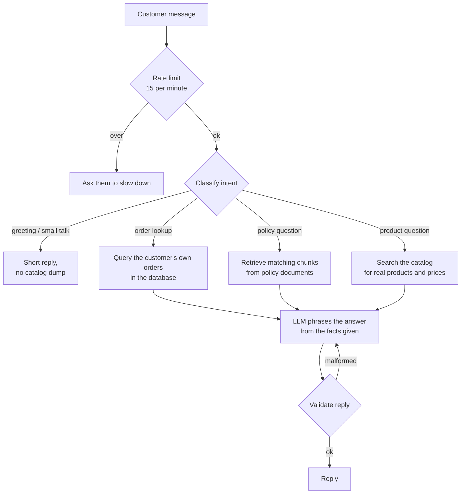

# Case study: RedCart

**An online store with an AI shopping assistant, built solo (Dec 2025 – present).**
Live: [redcart-ten.vercel.app](https://redcart-ten.vercel.app) · Next.js storefront: [redcart-storefront.vercel.app](https://redcart-storefront.vercel.app) · Author: [Afolabi Peter](https://www.linkedin.com/in/afolabipeter-dev)

---

## The problem

Small Nigerian electronics sellers run their business on WhatsApp: customers ask the same questions all day ("is it in stock?", "how much is delivery?", "where is my order?") and payment is a bank transfer and a screenshot. I wanted to build what a seller like that actually needs: a real store that takes payment, tracks orders, and answers customers at 2am **without making things up**.

## What I built

- A catalog of 103 products with search, categories, flash sales with countdowns and price history
- Accounts with email/password and Google sign-in, wishlists, reviews and notifications
- A Paystack checkout (test mode), PDF invoices and a full order lifecycle with tracking numbers
- An AI shopping assistant (Groq) that recommends products, answers policy questions and looks up orders
- Fraud scoring on reviews, with a moderation queue in the Django admin
- A second, faster storefront in **Next.js + TypeScript** that reads the same catalog through an API

## How it fits together

The Next.js storefront can only **read**. Anything that touches money or orders goes back to Django, so there is one place where an order can be created.

## How a chat message is handled

The model is never asked "what is the status of order 1042?". The code looks it up and the model only turns the facts into a friendly sentence.

## The hard parts

### 1. An AI assistant that doesn't lie
LLMs will happily invent a discount or say an item is in stock. My rules:
- **Facts come from code, not the model.** Order status and tracking numbers are read from the database, scoped to the logged-in customer. Stock and prices come from the catalog.
- **Policies come from documents.** Shipping, returns, warranty and payment answers are retrieved from markdown files in `products/knowledge/` (`products/rag.py`), so the bot quotes the real policy.
- **Guardrails in the prompt and in code.** The bot must never claim to have added something to the cart or invent a discount, and must say "I don't know" instead of guessing. Replies that come back malformed are retried.
- **Regression checks.** `scripts/evaluate.py` re-runs intent classification, guardrail, rate-limit and retrieval checks after changes.

### 2. Never trust the browser about payments
After the Paystack popup, the server calls `transaction/verify/{reference}` with the secret key, **recomputes the expected total from the cart, coupon and delivery insurance**, and refuses the order if Paystack's amount doesn't match. A reference that was already turned into an order is not processed again, so refreshing the success page can't create a second order.

### 3. Two frontends, one source of truth
The Next.js storefront talks to a small, versioned, read-only API (`/products/api/v1/products/`) with search, category, sort, on-sale filter and capped page sizes. Cross-origin access is limited to the storefront origins set in `STOREFRONT_ORIGINS`. Cart and checkout stay in Django, so I never had to keep two copies of order logic in sync.

### 4. Fake reviews without punishing real customers
Every review gets a fraud score from several signals: near-duplicate text across reviews, a burst of reviews on one product, brand-new accounts, and generic text with an extreme rating. Only **high-confidence** fraud is hidden automatically. Borderline reviews stay public and are flagged for staff, because hiding a genuine complaint is worse than showing a doubtful one.

### 5. No double credits
Referral rewards are paid into wallets inside a database transaction with `select_for_update()`, so two requests at the same moment can't pay the same reward twice.

## Results

- **83 passing Django tests** (74 for the store, 9 for the API), plus a TypeScript check of the storefront, run by GitHub Actions on every push
- Moved from Render to **Vercel + Neon Postgres**, and added the Next.js storefront on top of the existing API

## What I'd do next

- Paystack webhooks as a second confirmation path, in case the customer closes the tab before the redirect
- Move the payment checks into a small service function with its own unit tests, like I did for [Travel & Stays](https://github.com/peterafolabi-dev/travel-stays/blob/master/docs/CASE_STUDY.md)
- Proper embeddings for policy retrieval once the knowledge base grows beyond a few documents
